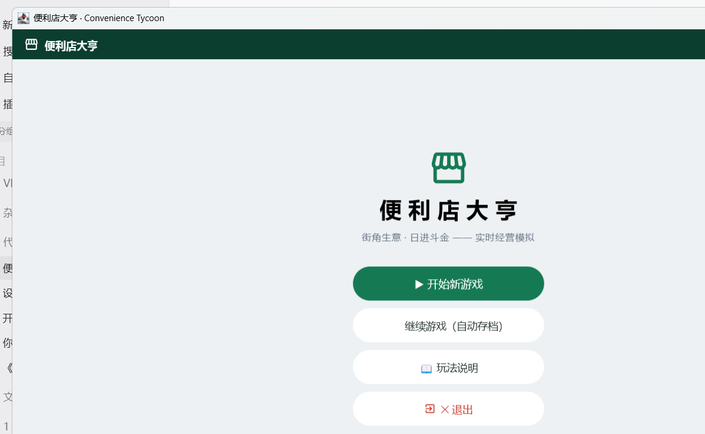
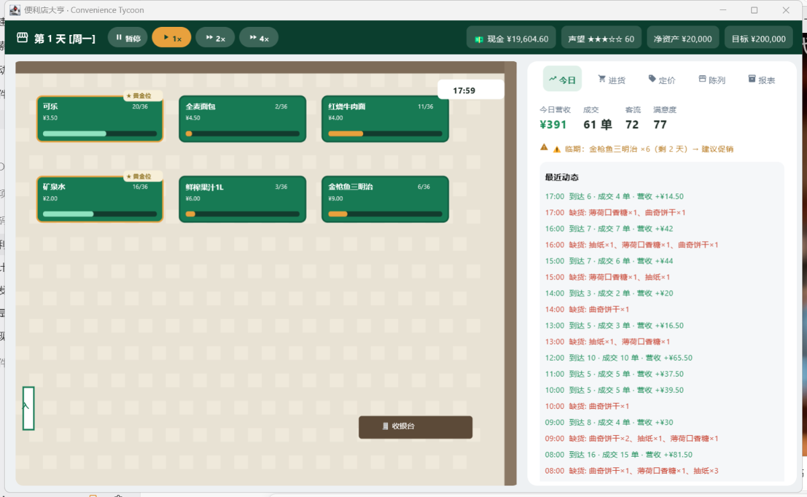

# 便利店大亨 · Convenience Tycoon

**实时便利店经营模拟游戏 —— 一套 Kotlin 代码，三端运行：Windows / 网页 / 安卓**

> 街角生意，日进斗金。进货、定价、陈列、促销、结算——时钟真实流动，
> 顾客实时进店选购排队结账，缺货的客人转身就走。经营你的街角小店，
> 把净资产滚到 ¥200,000！




## 玩法特色

- **实时模拟**：一天 16 个游戏小时，客流按早晚高峰波动；随时暂停或 2×/4× 加速
- **顾客 AI**：上班族/学生/银发族三类客群，各有时段、预算、耐心与商品偏好；
  缺货、宰客、排队过长都会流失客人并拉低声望
- **真实经营细节**：批次保质期（报纸只活 1 天！）、FIFO 先进先出、
  黄金位陈列、临期促销、供应商整箱进货
- **经营闭环**：每日结算损益 + 9 项 KPI（转化率/客单价/缺货率/周转/报废率…），
  满意度 → 声望 → 次日客流的正反馈循环
- **三端同一套核心**：Kotlin + Compose Multiplatform，
  经济引擎 20+ 单元测试覆盖（含端到端成交验收）

## 下载（v1.0.0）

| 平台 | 文件 | 说明 |
|---|---|---|
| Windows | 便利店大亨-1.0.0.msi | 安装版，含全部运行时，无需 Java |
| Android 12+ | 便利店大亨-安卓-1.0.2.apk | 直接安装（横屏） |
| 网页 | 便利店大亨-网页版.zip | 解压后运行「启动网页版.bat」 |

前往 [Releases](../../releases) 页面下载。

## 从源码构建

```bash
# 桌面版（可玩）
gradle :composeApp:run
# 网页版（产物在 composeApp/build/dist/wasmJs）
gradle :composeApp:wasmJsBrowserDevelopmentExecutableDistribution
# 安卓 APK（需 Android SDK）
gradle :composeApp:assembleDebug
```

要求：JDK 17+；安卓构建需 Android SDK（API 34）。

## 项目结构

- `convenience-store-tycoon-kmp/composeApp/src/commonMain/kotlin/tycoon/core/` — 游戏核心
  （仿真引擎 / 顾客 AI / 库存批次 / 结算账本，纯 Kotlin 零平台依赖）
- `composeApp/src/commonMain/kotlin/tycoon/ui/` — Compose 界面（三端共用）
- `composeApp/src/{desktopMain,androidMain,wasmJsMain}/` — 各平台入口
- `core/Balance.kt` 与 `config/` — 全部可调数值（无魔法数字）
- `tools/` 与 `art/` — 构建/截图/图标设计脚本

## 相关仓库

- [现实人生模拟器 · Life Simulator](https://github.com/uahz/life-simulator) —— 同作者另一款人生模拟游戏（PyQt6 桌面版 + 网页版，仓库内保留其设计文档与截图：`reality-life-simulator*`、`_shots/`）

## License

见 [LICENSE](LICENSE)。
