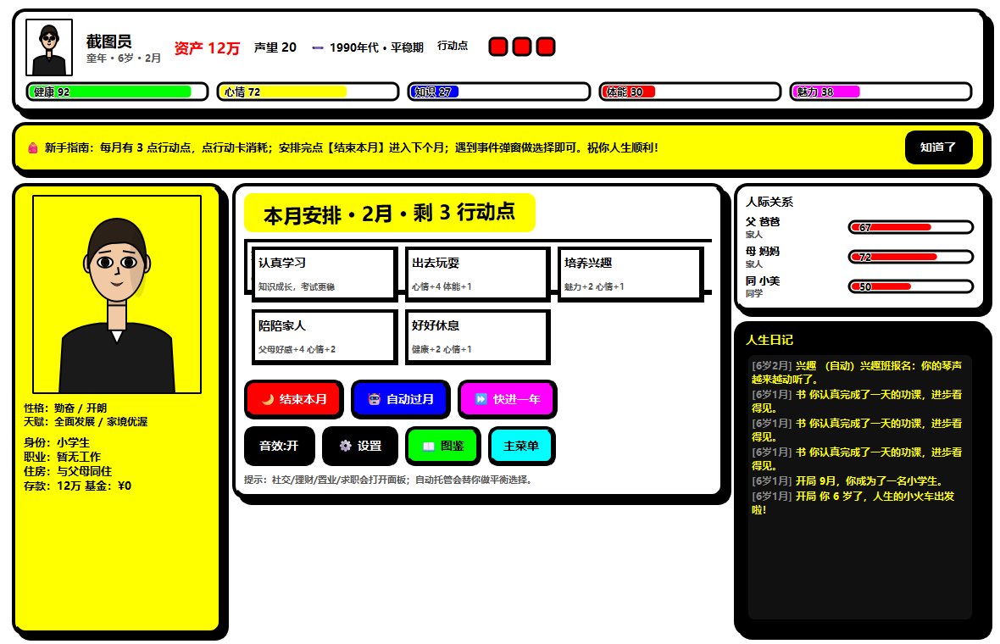
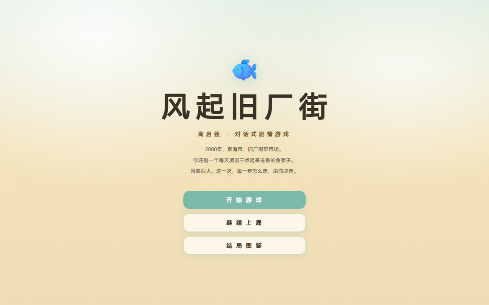

# 现实人生模拟器（Reality Life Simulator）

> 从 6 岁到白头，模拟一段温暖又真实的人生。
> Anti-Design（反设计）风格桌面游戏 · PyQt6 · Windows 免安装单文件 EXE



## ⬇️ 下载

前往 [Releases](../../releases) 页面下载 `RealityLifeSimulator.exe`（约 38MB，免安装，双击即玩）。

> 仅含 Windows 版。杀毒软件若对 PyInstaller 单文件报警，请添加信任。

## 🎮 玩法

- **角色创建**：姓名/性别、4 发型 × 4 发色 × 4 肤色 × 6 服装、8 选 2 性格特征、可重抽天赋（10 种）、4 档家庭背景
- **人生阶段**：童年 → 少年 → 中考分流（高中/职校）→ 高考（重点/本科/落榜复读）→ 大学选专业 → 职场 → 退休
- **10 条职业线**：程序员/医生/教师/设计师/教练/商务/餐饮/咖啡师/快递/零售，各 3-4 级晋升阶梯（需属性+年资达标）
- **社交婚恋**：好感度经营 → 表白 → 求婚 → 生子；父母、朋友、同事关系动态变化
- **生存压力**：房租/房贷、银行利息、基金波动（-12%~+28%）、健康衰减、心情管理
- **30+ 条件事件**：按年龄/性格/状态触发，选择驱动走向
- **结局结算**：S/A/B/C 评分 + 人生关键词 + 成就墙 + 完整人生时间线

操作：每月 3 行动点分配给学习/锻炼/社交/理财等行动；支持「自动过月」「快进一年」托管与 65 岁后「圆满谢幕」。自动存档于 `%APPDATA%\RealityLifeSimulator\save.json`。

## 🎨 风格

严格遵循 **Anti-Design** 规范：零圆角、4-6px 非对称粗黑边框、高饱和撞色（红/蓝/黄/品红/青/绿）、硬偏移阴影（无模糊）、倾斜标题、hover 生硬变色与边框跳变。人物肖像为写实比例的木刻平涂风（QPainter 自绘，表情随心情变化）。支持亮/暗双背景主题。

## 🛠️ 从源码构建

依赖：Python 3.12+、PyQt6、PyInstaller

```bash
pip install PyQt6 pyinstaller
python -m PyInstaller --onefile --windowed --name RealityLifeSimulator reality_life_simulator.py
```

## ✅ 质量验证

引擎自检（无 GUI 自动打完 4 段完整人生，退出码 0 为通过）：

```bash
python reality_life_simulator.py --selftest
```

界面截图（生成到 `_shots/`）：

```bash
python reality_life_simulator.py --shot
```

扩展压力测试：随机事件分支覆盖、职校/复读/社会人分流、社交婚恋链、理财买房边界、存档回路、晋升链——12 条模拟命全部通过（FAILS=0）。

## 📁 结构

```
reality_life_simulator.py        # 游戏源码（引擎 + 反设计 UI，单文件）
RealityLifeSimulator.exe         # Windows 免安装版（见 Releases）
reality-life-simulator-design.md # 游戏设计文档
reality-life-simulator.html      # v1 网页原型（已被桌面版取代，保留存档）
fengqi-jiuchangjie.html          # 《风起旧厂街》对话式剧情游戏（单文件 HTML）
fengqi-jiuchangjie-design.md     # 《风起旧厂街》设计文档
_shots/                          # 界面截图
```

---

# 🎣 风起旧厂街 · 高启强（对话式剧情游戏）

> 2000 年，京海市，旧厂街菜市场。你还是一个每天凌晨三点起来进鱼的鱼贩子。
> 三端发布：网页（吉卜力风格）/ Windows EXE / Android PWA（Luma 暗色 × 液态玻璃）· 零依赖 · 9 结局 · 13 成就
>
> 对话演出：14 位角色各配手绘 Q 版立绘（内联 SVG），随说话人在对话框边角轻柔浮现。

开源仓库：https://github.com/uahz/fengqi-jiuchangjie · 在线试玩：https://uahz.github.io/fengqi-jiuchangjie/fengqi-jiuchangjie.html · 安卓版（PWA，添加到主屏幕即装）：https://uahz.github.io/fengqi-jiuchangjie/mobile/



## 🎮 玩法

- **对话驱动**：40+ 剧情节点，四个时代（2000 旧厂街 → 2006 风起 → 2015 登顶 → 2021 潮退），打字机台词，点击/空格推进
- **五维属性**：💰资金 🐟声望 🤝人脉 ⚠️风险 ❤️初心；每个选项自带数值效果预览，部分选项需人脉达标或持有关键印记才能解锁
- **🌊 风浪回合**：章节之间的经营层——每时代 4 回合（卖鱼/读书/结交/打点/陪家人/拓张），45% 概率降临随机风浪事件（三个时代共 18 种）
- **🃏 谋略卡**：研读《孙子兵法》习得六张卡（瞒天过海/借刀杀人/反客为主/金蝉脱壳/以逸待劳/远交近攻），在六个关键剧情打出金色隐藏选项
- **👥 人物好感**：安欣/启盛/启兰/大嫂/老默/黄瑶六人好感面板，≥70 解锁专属隐藏选项，安欣好感 ≥75 亦通向"回头是岸"
- **🏆 成就系统**：13 枚成就（意难平、冻鱼传说、兵法宗师、六边形枭雄……），解锁即时 toast，图鉴成就页总览，结局页附"本次成就"
- **27 枚印记**：《孙子兵法》、安欣的名片、老默的忠心、保护伞、良知未泯……终局结算页完整回顾你走过的路
- **9 种结局**：潮退 / 京海之王·梦醒 / 回头是岸 / 灰烬 / 鱼死网破 / 亡命南洋 + 3 条章末风险检定败亡线；结局页附「人物命运」名单
- **S/A/B/C 评级 + 三页图鉴**（结局/成就/谋略）：localStorage 自动存档与进度持久化，多周目收集

操作：点击对话框推进剧情，点击选项做出抉择；⚠️风险≥70 时状态栏红色告警——章末检定不过，故事提前终结。

## 🎬 题材说明

基于电视剧《狂飙》前期故事的同人演绎，角色与事件均为艺术再创作；暴力情节全部侧写处理，结局传达「法网恢恢、回头是岸」。

## ✅ 质量验证

- 页面内置 `window.__qa(n)` 剧情图自检（节点引用完整性 + 随机选择模拟通关，含风浪回合）：实测 600 局随机通关 100% 到达结局、0 错误
- 浏览器实测标题/对话/抉择/过场/风浪回合/卡牌选项/好感面板/成就页/结局/图鉴截图验收（`_shots/gao-*.png`）

设计文档见 [fengqi-jiuchangjie-design.md](fengqi-jiuchangjie-design.md)，游戏本体 [fengqi-jiuchangjie.html](fengqi-jiuchangjie.html)。

## License

MIT
